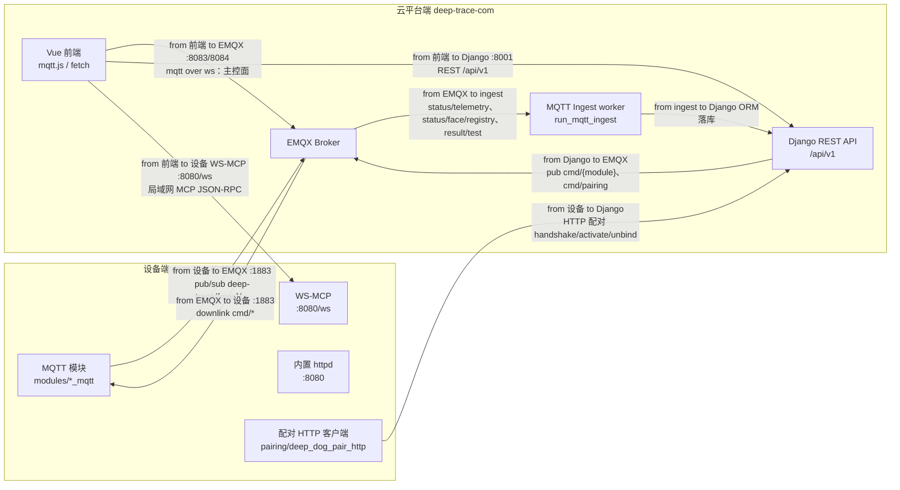

# 00 · 架构审查与优化建议

> 范围：**设备端** `xiaozhi-esp32/main/boards/deep-dog`（ESP32-S3 固件）与
> **云平台端** `deep-trace-com/{backend,frontend}`（Django + Vue）之间的通信架构与接口协议。
> 结论均核对到源码/文档出处；建议部分标注为「建议」，不含未验证事实。
> 契约版本：`interop-2`（2026-10）。

## 决策摘要（已拍板，指导后续实现）

| # | 决策 | 落点 |
|---|------|------|
| D1 | **统一所有 MQTT 话题**为单骨架 `{prefix}/{device_id}/{kind}/{subject}`；`deepdiary/deep-dog/...` 与 `deep-trace/{home}/{wu}/telemetry` 等旧前缀全部废弃 | [01-mqtt-contract.md](./01-mqtt-contract.md) |
| D2 | `{device_id}` = **设备 MAC 紧凑串**（硬件唯一、未绑定即稳定）；组织节点 `uuid` 降为业务属性 | [01 §2.1](./01-mqtt-contract.md) |
| D3 | `{prefix}` **可配置**（默认 `deep-trace`），三端从配置读取，改配置即可换前缀 | [01 §2.3](./01-mqtt-contract.md) |
| D4 | **移除配对 MQTT ingest**；配对/解绑**上行全走 HTTP**，MQTT 仅保留下行 `cmd/pairing` 通知 | [01 §5.6/§6](./01-mqtt-contract.md) |
| D5 | 契约真源用 **CI 校验**（两端常量集合与契约一致）保证，而非代码生成 | 本文 §4.1 |
| D6 | 云平台端仓库放置**契约镜像/指针**，便于前端不跨仓库开发 | [README.md](./README.md) |

---

## 1. 调研范围与方法

| 维度 | 设备端 | 云平台端 |
|------|--------|----------|
| MQTT | `mqtt/mqtt_config.*`、`mqtt/mqtt_client.*`、`mqtt/modules/*_mqtt.*` | `backend/devices/mqtt_standard.py`、`mqtt_publish.py`、`telemetry/consumers/*`、`devices/consumers/*` |
| WebSocket | `ws-mcp/deep_dog_ws_mcp_server.*` | `config/asgi.py`（无 Channels）、`frontend/src/composables/useDeviceWsMcp.js` 等 |
| HTTP | `http-server/deep_dog_http_server.cc`、`pairing/deep_dog_pair_http.cc` | 各 app `urls.py`/`views.py` |
| 契约文档 | `requirements/mqtt/protocol/deep-dog-mqtt.yml`、`M01`、`M02` | `docs/requirements/features/device-platform/unified-mqtt-subscription.md`、`docs/design/unified-device-architecture.md` |

---

## 2. 现状总览

### 2.1 运行时拓扑（from/to 标注）

### 2.2 传输通道矩阵（目标态）

| 通道 | 方向 | 协议 | 目标态 |
|------|------|------|--------|
| 模块控制 | 前端/后端 → 设备 | MQTT `{prefix}/{mac}/cmd/{module}` | ✅ 统一骨架 |
| 状态/信息 | 设备 → 前端/云端 | MQTT `{prefix}/{mac}/{info,status}/...` | ✅ 统一骨架 |
| 遥测 | 设备 → 云端 | MQTT `{prefix}/{mac}/status/telemetry` | ✅ 由旧 NS-3 迁入 |
| 配对 | 设备 ⇄ 云端 | **HTTP** handshake/activate/unbind + MQTT 下行 `cmd/pairing` | ✅ 上行去 ingest |
| 人脸库 | 设备 → 云端 | MQTT `{prefix}/{mac}/status/face/registry` | ✅ |
| 局域网调试 | 前端 → 设备 | WS `ws://{ip}:8080/ws` MCP JSON-RPC | ✅ |
| 边缘 Modbus | 前端 ⇄ 网关 | WS `ws://127.0.0.1:9100` + REST `/edge/*` | ✅ |
| FCT/ECU 工位 | 前端 ⇄ 工位 | MQTT（待随统一骨架评估，§4.2） | ⏳ |

---

## 3. 问题清单（分级）

### 3.1 P0 — 阻断独立开发 / 业务链路断裂

| # | 问题 | 证据 | 结论 |
|---|------|------|------|
| P0-1 | **统一命令通道未闭环**：后端发布 `deep-trace/{uuid}/cmd/{module}`，设备端**无任何**该前缀订阅 | `backend/devices/mqtt_publish.py:120-143` vs 设备端订阅仅旧前缀 | ✅ 已定 D1/D2：统一骨架 + `{device_id}`=MAC，设备端加 `cmd/#` 通配订阅 |
| P0-2 | **`deep-trace/` 根下两套不兼容骨架** | `mqtt_standard.py:30-41` vs `seed/.../HOME-DEMO.json:92` | ✅ 已定：遥测迁 `{prefix}/{mac}/status/telemetry`，废除 `{home}/{wu}` 形态 |
| P0-3 | **契约无单一真源**：YAML 缺字段；三端各自硬编码前缀 | YAML 缺 `motor/scan*`、`ws_mcp*`；`homeDevices.js:6`/`mqtt_standard.py:14`/`mqtt_config.cc:15` | ✅ 已定 D5：CI 校验；YAML 重写为新主题 |
| P0-4 | **设备标识双轨**（`device_id` vs `WorkUnit.uuid`） | `homeDevices.js:294-296` vs `DeviceHubPanel.vue:55-56` | ✅ 已定 D2：topic 只用 MAC；uuid 仅业务属性 |

### 3.2 P1 — 规范性缺陷（对应契约 §3/§4）

| # | 问题 | 证据 |
|---|------|------|
| P1-1 | 主题命名不成体系（`request`/`frames`/`tx`/`input`/`photo`/`active`/二级命名） | 设备端各 `*_mqtt.cc`；旧清单见 `interop-1` |
| P1-2 | 无统一载荷信封（旧报文根平铺、无 `schema`） | `mqtt_publish.py:156` vs `:131-139` |
| P1-3 | 统一通道字段与规格不符（`module` vs `action`；无 ack 订阅） | 规格 L58/L75-80 vs `mqtt_publish.py:131-139` |
| P1-4 | 时间字段三套（`ts` epoch / `ts` ISO / `ts_iso`） | `mqtt_publish.py:156`、`ingest.py:153`、`:134` |
| P1-5 | QoS/retain 不一致 | 设备端各 `*_mqtt.cc`（映射见 01 §5） |
| P1-6 | 前端心跳阈值多套（15s/10s/3s/45s） | `useUuidMqtt.js:18`、`useHomeDevicesPresence.js:10-12`、`useJoyNetHandleMqtt.js:23`、`useEcuStationMqtt.js:19` |

> P1 各项的**统一处理规则**已写入 [01-mqtt-contract.md §3/§4/§5](./01-mqtt-contract.md)，实现时按契约执行即可。

### 3.3 P2 — 工程治理 / 一致性 / 安全

| # | 问题 | 证据 |
|---|------|------|
| P2-1 | `dog/cmd`、`dog/status` 契约已定义但固件零实现 | `deep-dog-mqtt.yml:333-354` vs `mqtt/modules/` 无 dog |
| P2-2 | YAML `person/active` **重复键** | `yml:536-546` 与 `:1296-1307` |
| P2-3 | 已实现但契约缺失（`motor/scan*`、`ws_mcp*`） | `motor_mqtt.cc:216,240,714`、`device_mqtt.cc:157-160,186` |
| P2-4 | 契约已定义但代码未实现（`can/cmd.id_filter`、`pairing/status.ts_iso`） | `can_mqtt.cc:225-259`、`pairing_mqtt.cc:203-228` |
| P2-5 | `motor/status` 契约严重欠描述 | `yml:1249-1259` vs `motor_mqtt.cc:97-130` |
| P2-6 | 默认 broker 文档与代码相反 | `M01:37` vs `mqtt_config.h:18`、`mqtt_config.cc:102-110` |
| P2-7 | 硬编码散落（broker、HLS 域名、前端 broker 常量、`ws://127.0.0.1:9100`） | `mqtt_config.cc:15,57-69`、`mqttBroker.js:21-40` |
| P2-8 | clientId 前缀风格不一 | `useEcuStationMqtt.js:265`、`useMqttDevice.js:92` |
| P2-9 | 安全基线缺失（设备面 REST 无鉴权、HMAC 默认可空、WS-MCP 无鉴权、AI 视图 `AllowAny`） | `devices/views.py:165-166`、`services.py:524-532`、`ws-mcp/01:60`、`ai/views.py:26,...` |
| P2-10 | 同义别名命令冗余 | 各 `management/commands/run_*_ingest.py` |
| P2-11 | 能力重复上报通道（`fct_result` MQTT vs REST `POST /fct/test-results`） | `fct_result_ingest.py` vs `views_fct.py` |

---

## 4. 优化建议

> 原则：**统一收敛，不破坏在跑业务**；旧前缀经双订阅弃用期下线。

### 4.1 唯一契约真源 + CI 校验（D5）

- 以 `docs/interface/` + `deep-dog-mqtt.yml` 为跨端唯一真源。
- 两端 CI 各加一条单测：断言主题常量集合与契约文档/YAML 一致，不一致即失败。

### 4.2 统一命名空间（D1/D2/D3）

- 骨架：`{prefix}/{device_id}/{kind}/{subject}`；`{device_id}` = MAC；`{prefix}` 可配置（默认 `deep-trace`）。
- 旧前缀 `deepdiary/deep-dog/{device_id}/...`、`deep-trace/{home}/{wu}/telemetry` 全部迁移（映射表见 [01 §5](./01-mqtt-contract.md#5-主题全表统一后--旧新迁移)）。
- `dtp/{station_id}/...`（EOL/FCT）与 `joynet` 属独立域，本次不强制合并，但需登记为"已批准过渡前缀"，后续再评估统一。

### 4.3 命名与信封统一（P1）

- kind 词汇表 `info/status/cmd/event/result`（+ `cmd/*/ack`）；禁止语义不明后缀。
- 统一信封（`schema`/`ts_iso`/`device_id`/`msg_id`/`corr_id`/`code`/`data`），业务字段收敛进 `data`。
- 统一错误码表（1xxx/2xxx/…），REST 与 MQTT `ack` 共用。

### 4.4 QoS / retain 统一（P1-5）

- 判据："过期还有意义 → retain=true；高频流式 → false"；`cmd`/`ack`/`event`/`result` 一律 QoS1/0 + retain false。
- 逐模块结论见 [01 §5](./01-mqtt-contract.md)。

### 4.5 配置集中化（P2-6/7/8）

- broker/host/port/前缀全部走配置；删除硬编码域名；clientId 统一 `<product>-<role>-<rand>`。

### 4.6 配对 ingest 精简（D4）— 专项评估

现状：配对信息有**两个写入方**——HTTP `handshake` 与 MQTT `pairing/status` 都写同一张 `PendingPairing` 表
（[services.py:626-638](file:///D:/working/test-platform/deep-trace-com/backend/devices/services.py#L626-L638) 与
[services.py:76-105](file:///D:/working/test-platform/deep-trace-com/backend/devices/services.py#L76-L105)），存在状态竞争。

**结论与处理**：

| 通道 | 现状用途 | 处理 |
|------|----------|------|
| MQTT `pairing/status`（↑） | 被动建 `PendingPairing` | **删除**（与 HTTP handshake 重复；配对码权威来源唯一为 HTTP） |
| MQTT `pairing/request`（↑） | 设备主动解绑 | **删除**，改为设备面 HTTP `POST /devices/pair/unbind` |
| MQTT `pairing/cmd`（↓） | 云端通知设备绑定/解绑 | **保留**，迁为 `{prefix}/{mac}/cmd/pairing`（下行通知，非 ingest） |
| MQTT `telemetry`（↑） | 遥测落库 | **保留**（唯一/主通道，迁为 `status/telemetry`） |
| MQTT `face/registry`（↑） | 人脸库镜像 | **保留**（唯一来源） |
| MQTT `fct_result`（↑） | 工位测试结果 | 保留（P2-11：与 REST 重复，后续评估收敛） |

- ingest 变更：`ALL_CHANNELS` 去掉 `pairing`，仅留 `telemetry`/`face`/`fct_result`
  （[unified_mqtt_ingest.py:30](file:///D:/working/test-platform/deep-trace-com/backend/telemetry/consumers/unified_mqtt_ingest.py#L30)）；
  `PairingMqttIngest`（`devices/consumers/pairing_ingest.py`）退役。
- 净效果：配对状态**单一来源（HTTP）**，去掉一个 MQTT 中转。

### 4.7 接口审计清单（新增/修改接口必须逐条通过）

| 检查项 | 要求 |
|--------|------|
| 命名 | 符合 [01 §3](./01-mqtt-contract.md) 词汇表；`cmd`↔`status` 成对；无二级"状态在末尾" |
| 命名空间 | 属于统一骨架 `{prefix}/{mac}/...`，或登记在案的过渡前缀（`dtp`/`joynet`） |
| 前缀 | 不硬编码 `deep-trace`，一律读配置 |
| 信封 | 含 `schema`+`ts_iso`+`device_id`；命令含 `msg_id`；应答含 `corr_id`；业务字段在 `data` |
| QoS/retain | 符合 [01 §3.3](./01-mqtt-contract.md) 判据 |
| 版本 | `schema` 版本递增规则明确；新字段可选、不破坏旧端 |
| 真源 | 已写入 `docs/interface/` 与 `deep-dog-mqtt.yml` |
| 安全 | 不透传密钥；鉴权模型明确；WS 边界清晰 |
| 幂等 | 命令类接口说明幂等性与重放影响 |

**不符合以上任一条的接口，评审一律驳回。**

### 4.8 安全基线（P2-9）

- 设备面 REST（`/devices/pair/*`、`/edge/*`）补签名/HMAC（现默认空即放行）。
- WS-MCP：局域网绑定 + 可选 token，明确"仅同网段调试"边界。
- AI 视图显式声明权限，禁止默认 `AllowAny`。

---

## 5. 迁移路线图（不破坏现有业务）

| 阶段 | 动作 | 影响面 | 回滚 |
|------|------|--------|------|
| 零 | 冻结契约；重写 `deep-dog-mqtt.yml` 为新主题；补缺口/删重复键 | 仅文档 | — |
| 一 | 三端前缀改可配置；设备端加 `cmd/#` 通配订阅；新旧前缀双发/双订 | 三端 | 配置回退 + 关新订阅 |
| 二 | 移除配对 MQTT ingest；新增设备面 HTTP 解绑；`cmd/pairing` 迁新前缀 | 后端 + 设备 | 恢复 ingest 通道 |
| 三 | `ack`（`corr_id`）落地；统一信封与错误码；心跳阈值集中 | 三端 | 保留旧字段 |
| 四 | 旧前缀（`deepdiary/deep-dog`、`{home}/{wu}/telemetry`）下线 | 三端 | 需评估，谨慎 |

> 每阶段完成后更新本目录文档与 [README.md](./README.md) 的"当前状态"。

---

## 6. 风险与回滚

| 风险 | 说明 | 缓解 |
|------|------|------|
| 双订阅期消息重复 | 同命令两套 topic 各收一次 | `msg_id` 幂等去重；过渡期只在一侧发布 |
| UUID↔device_id 映射 | 遥测按 `device_id` 收，需映射到 WorkUnit 落库 | 后端建唯一映射表并校验；配对时写入 |
| 前缀变更影响面 | 属破坏性变更 | 三端同步发布 + 公告期；配置集中 |
| 设备订阅/内存 | 统一后订阅更集中 | 用 `cmd/#` 单条通配，反而减少订阅数 |
| 契约冻结拖慢迭代 | 流程变慢 | CI 校验自动化 |

---

## 7. 验收标准

- [ ] `docs/interface/` 五份文档就绪并被两端引用；`deep-dog-mqtt.yml` 完成新主题重写。
- [ ] D1~D6 全部落地或有明确阶段计划。
- [ ] 配对仅剩 HTTP 单一来源；`pairing` ingest 退役并验证遥测/人脸库/测试结果无回归。
- [ ] 三端前缀均可配置；改配置即整体换前缀。
- [ ] 新增接口 100% 通过 §4.7 审计清单。
- [ ] 两端各新增 CI 校验：主题集合与契约一致。

---

## 8. 复查记录（3 轮）

按"实现 → 复查 → 按默认优化"循环执行，结论如下。

### 第 1 轮：本轮改动暴露的问题

| 发现 | 处理（默认选择） |
|------|------------------|
| 后端 `bind`/`add` 响应的 `mqtt_topic_prefix` 与 `_typed_edge.topics` 仍用旧前缀 | ✅ 全部改用 `topic_root()`/`unified_topic` |
| `test_pair_http` 断言旧前缀 | ✅ 更新为 `deep-trace/...` |
| Hub 任务栈区块在 `status` 无 `tasks` 时误显示"等待心跳" | ✅ 文案改为"设备未上报任务栈…" |
| 前端 `UuidMqttPanel`/`useUuidMqtt` 用快照常量拼前缀 | ✅ 改 `topicRoot()`（运行期动态） |

### 第 2 轮：跨模块一致性

| 发现 | 处理 |
|------|------|
| 设备端各模块 topic 已集中化；`telemetry_mqtt` 走配置注入（非硬编码） | ✅ 保持；契约登记 |
| 前端 `homeDevices.moduleTopic` 与 `mqttUnified.unifiedTopic` 双入口 | ✅ 二者同源（moduleTopic 委托 unifiedTopic），文档标注 |
| 后端 `MQTT_TOPIC_ROOT` 常量（快照）与 `topic_root()` 并存 | ✅ 保留兼容；新代码用 `topic_root()` |
| 统一信封（`schema`/`data`）设备端 payload 仍为扁平 | ⏳ 列为阶段三（设备端 JSON 构造需同步改造，影响面大） |

### 第 3 轮：工程治理

| 发现 | 处理 |
|------|------|
| 缺"契约 ↔ 代码"一致性校验 | ✅ 新增后端单测 `devices/tests/test_mqtt_standard.py`（前缀可配置/kind 全集/ack 形态）；前端沿用 `mqttUnified` 单测 |
| `deep-dog-mqtt.yml` 旧主题/重复键 | ✅ 重写 `0.2.0`（44 topics，去重） |
| 板级旧文档（`requirements/mqtt/**`、`input/**`、`vision/infra.md`）仍写旧前缀 | ⏳ 需逐篇同步（建议随下次板级文档维护批量改，本文档为权威替代） |
| `ingest` 仍从 DB 订阅旧 `telemetry` topic | ⏳ 过渡期保留（新骨架通配已覆盖）；待 seed 更新后清理 |

### 复查结论

- 本轮 P0 全部闭环；配对链路单一来源（HTTP）；MQTT 话题三端统一且前缀可配置。
- 遗留项均为**渐进式**（统一信封、旧文档同步、旧 topic 清理），不阻断两端独立开发。
- 建议下一步：按 §5 阶段三/四推进，并为两端接入同一份契约校验（可复用本目录文档做数据源）。
