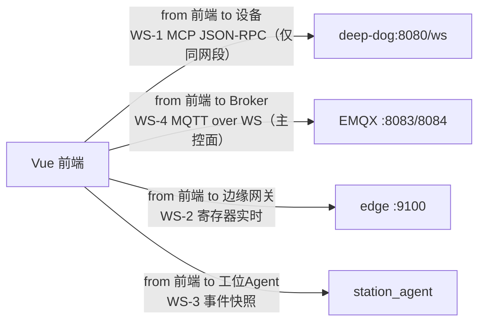

# 02 · WebSocket 标准接口契约

> 契约版本：`interop-1`（2026-10）
> 关联：[01-mqtt-contract.md](./01-mqtt-contract.md) · [03-http-api-contract.md](./03-http-api-contract.md)

---

## 1. 通道清单（现状）

| # | 通道 | 发起方 → 目标 | 地址 | 协议 | 状态 |
|---|------|----------------|------|------|------|
| WS-1 | 设备 WS-MCP | 前端/脚本 → 设备 | `ws://{device_ip}:8080/ws` | MCP JSON-RPC | ✅ PoC |
| WS-2 | 边缘 Modbus 寄存器 | 前端 → 边缘网关 | `ws://127.0.0.1:9100` | 自定义 JSON | ✅ |
| WS-3 | 工位事件 | 前端 → 工位 Agent | `${agentWsBase}/station/events` | JSON 快照 | ✅ |
| WS-4 | MQTT over WebSocket | 浏览器/ingest → Broker | `ws://{host}:8083/mqtt` / `wss://broker.emqx.io:8084/mqtt` | MQTT 3.1.1 | ✅ 主控面 |

> **重要澄清**：云平台端 `deep-trace-com/backend`（Django）**没有 Channels / 服务端 WebSocket**。
> 其"实时"能力由两部分构成：① 独立进程的 MQTT worker（`manage.py run_mqtt_ingest`）；
> ② 浏览器直连 Broker 的 MQTT-over-WS（WS-4）。SSE 仅用于 AI 聊天流（`backend/ai/views.py:53-84`）。
> 即 **WS-4 是"用 WebSocket 承载 MQTT"，不是一套独立的业务 WS 协议**。



---

## 2. WS-1 · 设备 WS-MCP（局域网通用调试桥）

### 2.1 端点与开关

| 项 | 值 | 出处 |
|----|----|------|
| 开关 | `DEEP_DOG_WS_MCP_ENABLE`（默认：`(MOTOR&&!DOG)||FACE_AI` 时为 1） | `ws-mcp/ws_mcp_config.h:12-18` |
| 端口 | `8080`（`DEEP_DOG_WS_MCP_PORT`） | `ws_mcp_config.h:20-22` |
| 路径 | `/ws`（`DEEP_DOG_WS_MCP_PATH`） | `ws_mcp_config.h:24-26` |
| 单帧上限 | 4096 字节 | `ws_mcp_config.h:29-31` |
| 发现方式 | `info/device` 广播 `ip` / `ws_mcp_port` / `ws_mcp_path` / `capabilities.ws_mcp` | `device_mqtt.cc:157-160,186` |
| 与内置 httpd | 编译期 `#error` 阻止同端口 | `ws_mcp_config.h:33-37` |

### 2.2 URL 构造（前端）

```
ws://{ip}:{port}{path}      # 默认 ws://<device-ip>:8080/ws
```

来源优先级（`frontend/src/composables/deviceWsUrl.js:28-46`）：手动填写 > 实时 `info/device` > 本地缓存 `lastAutoUrl`。

### 2.3 消息封装

两种入站格式，二者均可（`deep_dog_ws_mcp_server.cc:168-183`）：

```jsonc
// ① 直发 JSON-RPC
{ "jsonrpc":"2.0", "id":1, "method":"tools/list", "params":{} }

// ② 信封
{ "type":"mcp", "payload": { "jsonrpc":"2.0", "id":1, "method":"tools/call",
  "params": { "name":"self.get_device_status", "arguments":{} } } }
```

### 2.4 支持方法（标准 MCP）

| 方法 | 说明 |
|------|------|
| `initialize` | 会话初始化 |
| `tools/list` | 列出设备已注册工具 |
| `tools/call` | 调用工具（`params.name` + `params.arguments`） |

- 工具命名空间：`self.board.*`、`self.get_device_status`、`self.motor.*`、`self.can.*`、`self.camera.*` 等（由 `McpServer::AddTool` 注册）。
- 响应经 `RegisterMcpBroadcastCallback` → `BroadcastMessage` **广播到所有已连接 WS 客户端**。

### 2.5 限制与待改善

| 项 | 现状 | 建议 |
|----|------|------|
| 鉴权 | **无** | 至少绑定局域网 + 可选 token |
| TLS | **无** | 保持局域网边界，文档明示 |
| 心跳 | **未实现**（仅 CLOSE 帧清理） | 增加应用层 ping/pong 或超时剔除 |
| 单帧上限 | 4096 | 大响应分片或改走 HTTP |
| 广播语义 | 所有客户端都收到所有响应 | 按 `id` 定向回发（避免多客户端串扰） |

---

## 3. WS-2 / WS-3 · 前端其它原生 WebSocket

| 通道 | 地址 | 消息格式 | 出处 |
|------|------|----------|------|
| WS-2 寄存器 | `ws://127.0.0.1:9100` | `{type:"status"}` 或 `{items:[...]}` | `frontend/src/composables/useEdgeRegsWs.js:4,30-36`；`useStationEdgeTransport.js:7,85-95` |
| WS-3 工位事件 | `${agentWsBase}/station/events` | JSON 快照（`phase` 等） | `useStationWebSocket.js:121`；`agentBase.js:27-33` |

> WS-2 与 MQTT 通道并存（`useStationEdgeTransport` 优先 WS、失败回退 MQTT）。建议统一为单一数据面（见 §6）。

---

## 4. WS-4 · MQTT over WebSocket 接入规范

| 项 | 规范 |
|----|------|
| Broker（内网） | `ws://{lan-host}:8083/mqtt` |
| Broker（公网） | `wss://broker.emqx.io:8084/mqtt` |
| 传输映射 | ws=8083 / wss=8084 / tcp=1883 / tls=8883；默认 path `/mqtt` |
| 协议版本 | MQTT 3.1.1（`protocolVersion:4`） |
| 客户端选项 | `clean:true`，`reconnectPeriod:4000`，`resubscribe:true` |
| clientId | `<product>-<role>-<rand>`，如 `dt-web-1a2b3c4d`（见 §5.2） |
| 环境切换 | `VITE_NETWORK_VIA`=`web`|`lan`；dev 默认 `lan`，prod 默认 `web` |
| QoS | `cmd`=1；`info`/`status`/`event`/`result`=0 |
| topic 前缀 | 读配置 `VITE_MQTT_TOPIC_ROOT`（默认 `deep-trace`），**不得硬编码** |

出处：`frontend/src/composables/mqttBroker.js:21-40,178-193`、`src/config/mqttTransport.js:10-19`。
topic 骨架与载荷规范见 [01-mqtt-contract.md](./01-mqtt-contract.md)。

> **topic 与载荷**：WebSocket 仅是承载，话题与报文规范一律见 [01-mqtt-contract.md §3–§6](./01-mqtt-contract.md)。

---

## 5. 心跳 / 重连 / 超时 规范

### 5.1 现状（阈值分散，需统一）

| 场景 | 判活阈值 | 出处 |
|------|----------|------|
| 统一通道订阅 | 15s | `useUuidMqtt.js:18` |
| 设备列表在线 | 15s / 首包 10s | `useHomeDevicesPresence.js:10-12` |
| joynet 手柄 | 3s | `useJoyNetHandleMqtt.js:23` |
| ECU 工位 | 45s | `useEcuStationMqtt.js:19` |
| MQTT 重连 | 4000ms | `mqttBroker.js:178-193` |
| 设备 MQTT 重连 | ~3s | `requirements/mqtt/M01:39` |

### 5.2 建议（统一规范）

| 项 | 建议值 |
|----|--------|
| 设备心跳周期 | `status/device` 每 5s（现 `status/device` publish_hz=0.2 即 5s，一致） |
| 端侧在线判定 | 3 × 心跳周期 = 15s（集中为单一常量） |
| 首包等待 | 10s |
| clientId 规则 | `<product>-<role>-<rand>`，禁止混用风格 |
| WS-1 心跳 | 30s 应用层 ping/pong；无响应 2 次剔除 |

---

## 6. 待改善（对应架构审查）

- [ ] WS-1 增加心跳与定向回发，明确"仅局域网调试"边界并登记在契约。
- [ ] 统一在线判定阈值（消除 3s/10s/15s/45s 四套）。
- [ ] WS-2 与 MQTT 双数据面收敛为单一通道（评估后择一）。
- [ ] 明确"云端无 WS、实时=MqttOverWS+SSE"的架构事实，写入两端 README 避免误判。
