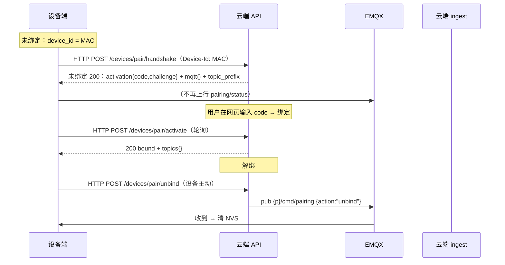

# 01 · MQTT 标准接口契约

> 契约版本：`interop-2`（2026-10）——**统一命名空间**定稿
> 前缀与字段真源：[../mqtt/protocol/deep-dog-mqtt.yml](../mqtt/protocol/deep-dog-mqtt.yml)
> 关联：[00-architecture-review.md](./00-architecture-review.md) · [02-ws-contract.md](./02-ws-contract.md) · [03-http-api-contract.md](./03-http-api-contract.md)

**本版决议（已拍板）**：
1. **全端统一**为一条 topic 骨架：`{prefix}/{device_id}/{kind}/{subject[/...]}`。`deepdiary/deep-dog/...` 与
   `deep-trace/{home}/{wu}/telemetry` 等旧前缀**全部废弃**（弃用期见 §8）。
2. `{device_id}` = **设备硬件唯一标识**：STA MAC 紧凑串（小写无冒号，如 `aabbccddeeff`）；**未绑定即稳定**。
   组织节点 `uuid` 降为业务属性，不进 topic。
3. `{prefix}` **可配置**（默认 `deep-trace`），三端从配置读取，改配置即可整体换前缀（见 §2.3）。
4. 配对**上行改走 HTTP**，MQTT 配对 ingest 中转移除（见 §6、[03-http-api-contract.md §B](./03-http-api-contract.md)）。

---

## 1. 范围与角色

| 角色 | 代码位置 | 职责 |
|------|----------|------|
| 设备端 | `main/boards/deep-dog/mqtt/` | 发布 `info`/`status`/`event`/`result`/`ack`；订阅 `cmd` |
| 云端 worker | `backend/telemetry/consumers/`、`backend/devices/consumers/` | 订阅上行（遥测/人脸库/测试结果）落库 |
| 云端 API | `backend/devices/mqtt_publish.py`、`mqtt_standard.py` | 发布下行 `cmd` |
| 前端 | `frontend/src/iot/`、`use*Mqtt.js` | 订阅 `info`/`status`，发布 `cmd` |

---

## 2. 统一命名空间

### 2.1 骨架（唯一）

```
{prefix}/{device_id}/{kind}/{subject[/...]}
```

| 段 | 取值 | 说明 |
|----|------|------|
| `{prefix}` | 可配置，默认 `deep-trace` | 见 §2.3 |
| `{device_id}` | MAC 紧凑串（小写无冒号） | 设备唯一且稳定；未绑定也用此值 |
| `{kind}` | `info` \| `status` \| `cmd` \| `event` \| `result` | 见 §3.1 |
| `{subject}` | 模块名，可多级 | 如 `imu`、`led`、`face/registry`、`motor/teaching` |

示例：
```
deep-trace/aabbccddeeff/info/device        # 上线快照（retain）
deep-trace/aabbccddeeff/status/imu         # IMU 实时（高频）
deep-trace/aabbccddeeff/status/face/registry
deep-trace/aabbccddeeff/cmd/led            # 命令下发
deep-trace/aabbccddeeff/cmd/led/ack        # 命令应答
deep-trace/aabbccddeeff/event/stream/photo
```

### 2.2 订阅拓扑（模块只订自己关心的细化话题）

| 订阅方 | 订阅式 | 说明 |
|--------|--------|------|
| 设备端（收命令） | `{prefix}/{device_id}/cmd/#` | **单条通配**覆盖全部模块命令，替代逐模块订阅 |
| 前端·设备页 | `{prefix}/{device_id}/info/#`、`…/status/#` | 快照+实时 |
| 前端·单模块页 | `{prefix}/{device_id}/status/{module}` 等细化话题 | 只订当前模块 |
| 云端 ingest·遥测 | `{prefix}/+/status/telemetry` | 通配所有设备 |
| 云端 ingest·人脸库 | `{prefix}/+/status/face/registry` | |
| 云端 ingest·测试结果 | `{prefix}/+/result/test` | |

> 禁止：无边界通配 `{prefix}/#`；越权订阅其它设备 `{prefix}/{other_id}/#`。

### 2.3 前缀可配置（三端）

| 端 | 配置项 | 默认 | 优先级 |
|----|--------|------|--------|
| 设备端 | 编译期 `DEEP_DOG_MQTT_TOPIC_ROOT` + NVS `deep_dog_mqtt.topic_prefix` | `deep-trace` | 配对 200 下发值 > NVS > 编译期默认 |
| 云端 worker/API | 环境变量 `MQTT_TOPIC_ROOT`（现 `mqtt_standard.py` 硬编码常量改为读 env） | `deep-trace` | 环境变量 > 代码兜底 |
| 前端 | Vite env `VITE_MQTT_TOPIC_ROOT`（`mqttUnified.js` 读配置） | `deep-trace` | 环境变量 > 代码兜底 |

> 换前缀只需改配置（如 `deep-trace` → `dtr`），三端同步生效；**跨端配置文件必须记录当前生效前缀**。

---

## 3. 主题命名规范

### 3.1 kind 词汇表（强约束）

| kind | 方向 | QoS | retain | 语义 |
|------|------|-----|--------|------|
| `info` | 设备→端 | 0 | ✅ | 上线快照（能力/固件/元数据） |
| `status` | 设备→端 | 0 | 见 §3.3 | 心跳 / 实时状态 / 快照 |
| `cmd` | 端→设备 | 1 | ❌ | 命令下发（应答为 `cmd/{subject}/ack`） |
| `event` | 设备→端 | 0 | ❌ | 一次性事件（拍照完成、发现新设备…） |
| `result` | 设备→端 | 0 | ❌ | 测试/计算结果帧 |

- `ack` 不单列 kind，作为 `cmd/{subject}/ack` 存在于 `cmd` 命名空间（设备→端）。
- **禁止**：语义不明后缀（`frames`/`tx`/`input`/`photo`/`active`/`request` 等，一律归入上述 kind + `subject`）。

### 3.2 subject 分级

- 单级：`status/imu`、`status/led`、`cmd/led`。
- 多级：`status/face/registry`、`status/motor/teaching`、`event/stream/photo`。
- 规则：`subject` 第一级是模块名；多级表示子资源，**不再使用 `xxx/status` 这种"状态在末尾"的旧式**。

### 3.3 QoS / retain 统一规则

| 类别 | QoS | retain | 判据 |
|------|-----|--------|------|
| `info` | 0 | true | 上线快照，晚订阅者需拿到 |
| `status`·快照型 | 0 | **true** | 低频、代表当前状态（device/led/servo/gimbal/touch/can/motor/face/registry/handle/keymap/person） |
| `status`·流式型 | 0 | **false** | 高频、过期无意义（imu、telemetry、can/frames、face/detect、track、handle/status） |
| `cmd` / `cmd/*/ack` | 1 | false | 命令与应答 |
| `event` / `result` | 0 | false | 一次性 |

> 判据一句话：**"过期还有意义 → retain=true；高频流式 → false"**。逐模块见 §5。

---

## 4. 统一载荷信封

### 4.1 信封（所有报文必须遵循）

```json
{
  "schema": "deep-trace.status.v1",
  "ts_iso": "2026-10-14T12:00:00+08:00",
  "device_id": "aabbccddeeff",
  "seq": 128,
  "msg_id": "cmd-7f3a91c2",
  "corr_id": "cmd-7f3a91c2",
  "code": 0,
  "data": { }
}
```

| 字段 | 类型 | 出现 | 说明 |
|------|------|------|------|
| `schema` | string | 全类 | `<domain>.<kind>.v<N>`，如 `deep-trace.cmd.v1` |
| `ts_iso` | string | 全类 | **唯一时间字段**，ISO8601 带时区 |
| `device_id` | string | 全类 | MAC 紧凑串，与 topic 第 2 段一致 |
| `device_uuid` | string | 可选 | 组织节点 uuid（业务属性，非 topic 段） |
| `seq` | int | 可选 | 单调递增序号，便于丢包检测 |
| `msg_id` | string | `cmd` | 命令唯一 ID |
| `corr_id` | string | `cmd/*/ack` | 回填被应答命令的 `msg_id` |
| `code` | int | `ack`/`result` | 0=成功，非 0 见 §4.3 |
| `data` | object | 按类 | **业务字段全部收敛进 `data`**，不与信封平铺混用 |

### 4.2 约束

- 时间：**一律 `ts_iso`**；不再使用 `ts`(epoch 秒) 作为对外时间字段（过渡期可双发）。
- **禁止**在根平铺业务字段（如旧 `{"mode":1,"r":0,...,"ts":...}`）；必须放入 `data`。
- 密钥/大图不上 MQTT。

### 4.3 统一错误码（`code`）

| 段 | 范围 | 含义 |
|----|------|------|
| 0 | 0 | 成功 |
| 1xxx | 1001-1099 | 请求错误（invalid_json/missing_field/bad_param/unknown_action） |
| 2xxx | 2001-2099 | 状态错误（not_ready/busy/unsupported/auto_stop_timeout） |
| 3xxx | 3001-3099 | 资源错误（no_resource/sensor_error/storage_full） |
| 4xxx | 4001-4099 | 硬件/总线错误（bus_collision/no_rtp/push_error） |
| 9xxx | 9001-9099 | 内部错误（internal/panic_recover） |

> 与 REST、`ack` 共用同一码表（[03-http-api-contract.md §D](./03-http-api-contract.md#d-统一响应与错误码建议)）。

---

## 5. 主题全表（统一后 + 旧→新迁移）

> `{p}` = `{prefix}/{device_id}`。方向：`↑`设备→端，`↓`端→设备。
> **旧主题** = 现 `deepdiary/deep-dog/{mac}/...`（迁移后废弃）。

### 5.1 设备与信息

| 新主题 | 旧主题 | 方向 | QoS | retain | 关键 data 字段 |
|--------|--------|------|-----|--------|----------------|
| `{p}/info/device` | `device/info` | ↑ | 0 | ✅ | `firmware, board, chip_model, ip, http_port, ws_mcp_port, ws_mcp_path, capabilities{}, ext_pins` |
| `{p}/status/device` | `device/status` | ↑ | 0 | ❌ | `online, uptime_s, free_heap, min_free_heap, mem{}, rssi, health{}, clock_synced, tasks[]` |

### 5.2 视觉 / 人脸 / 跟踪

| 新主题 | 旧主题 | 方向 | QoS | retain | 关键 data 字段 |
|--------|--------|------|-----|--------|----------------|
| `{p}/cmd/stream` | `stream/cmd` | ↓ | 1 | ❌ | `action:{start,stop,take_photo}, mode?, question?` |
| `{p}/status/stream` | `stream/status` | ↑ | 0 | ✅ | `state, mode, url, lan_url, push_url, code?, voice_paused` |
| `{p}/event/stream/photo` | `stream/photo` | ↑ | 0 | ❌ | `ok, result?, code?, elapsed_ms` |
| `{p}/cmd/face` | `face/cmd` | ↓ | 1 | ❌ | `enabled?, action?, local_id?, target_local_id?, display_name?, pipeline?, detect_interval_ms?` |
| `{p}/status/face` | `face/status` | ↑ | 0 | ❌ | `enabled, recognize_enabled, pipeline, n, w, h, primary?, faces[]` |
| `{p}/status/face/registry` | `face/registry` | ↑ | 0 | ✅ | `version, count, feat_count, max_count, entries[]` |
| `{p}/status/face/immich` | `face/immich/status` | ↑ | 0 | ✅ | `configured, url, key_len, server_ok, ping_ms` |
| `{p}/status/person/active` | `person/active` | ↑ | 0 | ✅ | `local_id, display_name?, immich_person_id?` |
| `{p}/cmd/track` | `track/cmd` | ↓ | 1 | ❌ | `action:{enable,disable}` |
| `{p}/status/track` | `track/status` | ↑ | 0 | ❌ | `enabled, following, target?, actuator, code?` |

### 5.3 运动 / 执行器

| 新主题 | 旧主题 | 方向 | QoS | retain | 关键 data 字段 |
|--------|--------|------|-----|--------|----------------|
| `{p}/status/imu` | `imu/status` | ↑ | 0 | ❌ | `ok, accel_*, gyro_*, pitch, roll, switches{}` |
| `{p}/cmd/led` | `led/cmd` | ↓ | 1 | ❌ | `mode, brightness?, r/g/b?, interval_ms?` |
| `{p}/status/led` | `led/status` | ↑ | 0 | ✅ | `mode, brightness, r/g/b, led_count, ok` |
| `{p}/cmd/servo` | `servo/cmd` | ↓ | 1 | ❌ | `index, angle?, duration_ms?, attach?, type?` |
| `{p}/status/servo` | `servo/status` | ↑ | 0 | ✅ | `servos[{index,angle,target,attached,moving}]` |
| `{p}/cmd/gimbal` | `gimbal/cmd` | ↓ | 1 | ❌ | `mode?, pan?, tilt?, speed?, action?, dir?` |
| `{p}/status/gimbal` | `gimbal/status` | ↑ | 0 | ✅ | `pan, tilt, moving_*, ready, lim_*` |
| `{p}/cmd/motor` | `motor/cmd` | ↓ | 1 | ❌ | `motor_id, enable?, reset?, position_rad?, mit?, teaching?, mcp_call?` |
| `{p}/cmd/motor/scan` | `motor/scan` | ↓ | **1** | ❌ | `{started, range}` 或 `{event:"discovered", id,…}` |
| `{p}/status/motor` | `motor/status` | ↑ | 0 | ✅ | `motors[{id,can_id,init_state,position_rad,…,fault}]` |
| `{p}/status/motor/tools` | `motor/tools` | ↑ | 0 | ✅ | `tools[]` |
| `{p}/status/motor/teaching` | `motor/teaching/status` | ↑ | 0 | ✅ | `recording, ready, motor_id?` |
| `{p}/event/motor/scan` | `motor/scan_result` | ↑ | 0 | ❌ | `{event:"discovered", id,…}` |
| `{p}/event/motor/mcp_result` | `motor/mcp_result` | ↑ | 0 | ❌ | `name, ok, result?, code?` |
| `{p}/event/motor/teaching` | `motor/teaching/snapshot` | ↑ | 0 | ❌ | `motor_id, point_count, samples[]` |

### 5.4 输入 / 外设 / 总线

| 新主题 | 旧主题 | 方向 | QoS | retain | 关键 data 字段 |
|--------|--------|------|-----|--------|----------------|
| `{p}/cmd/handle` | `handle/cmd` | ↓ | 1 | ❌ | `action, profile?, bindings?, axis_bindings?, led?, rumble?` |
| `{p}/cmd/handle/input` | `handle/input` | ↓ | **1** | ❌ | `connected, source, axes{}, buttons{}, touchpad?, motion?` |
| `{p}/status/handle` | `handle/status` | ↑ | 0 | ❌ | 与 `cmd/handle/input` 同构 |
| `{p}/status/handle/keymap` | `handle/keymap` | ↑ | 0 | ✅ | `schema_ver, profile, bindings, axis_bindings, catalog` |
| `{p}/cmd/touch` | `touch/cmd` | ↓ | 1 | ❌ | `action, persist?, buttons?, button_id?` |
| `{p}/status/touch` | `touch/status` | ↑ | 0 | ✅ | `ok, pressed_mask, buttons[], thresholds{}, calib?` |
| `{p}/cmd/can` | `can/cmd` | ↓ | 1 | ❌ | `tunnel?, mirror_tx?, allow_tx?, max_hz?, id_filter?` |
| `{p}/cmd/can/tx` | `can/tx` | ↓ | 1 | ❌ | `frames[{id,id_hex,ext,rtr,dlc,data_hex}]` |
| `{p}/status/can` | `can/status` | ↑ | 0 | ✅ | `ok, tunnel, allow_tx, bitrate_kbps, tx_gpio, rx_gpio, dropped` |
| `{p}/status/can/frames` | `can/frames` | ↑ | 0 | ❌ | `frames[{dir,id,id_hex,ext,rtr,dlc,data_hex,ts_ms}], dropped` |

### 5.5 遥测（原 NS-3 冲突解除）

| 新主题 | 旧主题 | 方向 | QoS | retain | 关键 data 字段 |
|--------|--------|------|-----|--------|----------------|
| `{p}/status/telemetry` | `deep-trace/{home}/{wu}/telemetry` | ↑ | 0 | ❌ | `points{field:{value,unit}}, program` |

> 旧遥测 topic 由云端按工位分配（`deep-trace/{home_code}/{work_unit_code}/telemetry`），与本骨架 **第 2 段语义冲突**。
> 新方案：遥测随设备统一到 `{prefix}/{device_id}/status/telemetry`；云端 ingest 改为通配订阅 `{prefix}/+/status/telemetry`，
> 再按 `device_id → WorkUnit` 映射落库（映射关系见 §7 与 [03-http-api-contract.md](./03-http-api-contract.md)）。

### 5.6 配对（MQTT 仅保留下行通知；上行全 HTTP）

| 新主题 | 旧主题 | 方向 | QoS | retain | 说明 |
|--------|--------|------|-----|--------|------|
| `{p}/cmd/pairing` | `pairing/cmd` | ↓ | 1 | ❌ | 云端通知设备 `action: bound\|unbind`（**唯一保留的配对 MQTT 主题**） |
| ~~`{p}/status/pairing`~~ | ~~`pairing/status`~~ | — | — | — | **废弃**：配对状态上行改走 HTTP（见 §6） |
| ~~`{p}/event/pairing_request`~~ | ~~`pairing/request`~~ | — | — | — | **废弃**：设备主动解绑改走 HTTP |

### 5.7 契约缺口（随本次迁移一并补齐）

| 项 | 处理 |
|----|------|
| `motor/scan`、`motor/scan_result` | 已纳入 §5.3（新主题） |
| `device/info.ws_mcp_port/ws_mcp_path`、`capabilities.ws_mcp` | 已纳入 §5.1，需回填 YAML |
| `dog/cmd`、`dog/status` | 纳入 `cmd/dog`、`status/dog`（契约已有，固件待实现） |
| `can/cmd.id_filter` | 契约保留，固件待实现 |
| `person/active` YAML 重复键 | 删除重复定义，保留 `status/person/active` 一处 |

---

## 6. 配对与解绑（上行 HTTP，MQTT 只做下行通知）



- **上行（设备→云端）**：`handshake` / `activate` / `unbind` 全走 HTTP；云端不再订阅任何 `pairing/*` MQTT 主题。
- **下行（云端→设备）**：保留 `{p}/cmd/pairing`（`action: bound|unbind`），供"网页侧解绑/绑定"即时通知设备。
- **云端 ingest 变更**：`ALL_CHANNELS` 去掉 `pairing`，仅保留 `telemetry` / `face` / `fct_result`
  （`backend/telemetry/consumers/unified_mqtt_ingest.py:30`）；`PairingMqttIngest` 相关代码退役。

---

## 7. 版本兼容规则

1. **契约版本**：整体 `interop-N`（本文档头）；报文版本 `schema`（§4.1）。
2. **新增**：只允许新增**可选**字段；接收方忽略未知字段。
3. **改名/删除**：必须经历**双写/双读弃用期（≥1 个契约版本）**，旧主题继续服务直至下线公告。
4. **主题迁移**：统一采用**双订阅期**——设备端同时订阅旧 `deepdiary/deep-dog/{mac}/…/cmd` 与新 `{prefix}/{mac}/cmd/#`；端侧同时订阅两套 `status` 一段时间。
5. **前缀变更**：改 `{prefix}` 属破坏性变更，需三端同步发布 + 公告期。
6. **下线**：两端均确认无消费方后方可执行，并在本目录留档。

---

## 8. 三端职责矩阵

| 能力 | 设备端 | 云端 ingest | 云端 API | 前端 |
|------|--------|-------------|----------|------|
| 配对 | HTTP handshake/activate/unbind | **不参与** | 发码/确认/解绑；下行 `cmd/pairing` | 输入配对码 |
| 设备信息 | 发 `info/device`、`status/device` | — | — | 订阅展示 |
| 模块控制 | 订阅 `cmd/#`、回 `ack` | — | 发 `cmd` | 发 `cmd`/订阅 `status` |
| 遥测 | 发 `status/telemetry` | 通配订阅落库 | REST 查询 | 图表展示 |
| 人脸库 | 发 `status/face/registry` | 通配订阅镜像 | REST 查询/删除 | 展示 |
| 测试结果 | 发 `result/test` | 通配订阅落库 | REST 查询 | 展示 |

---

## 9. 迁移与待办清单

- [ ] 设备端 `mqtt_config.cc` 前缀改为 `{prefix}`（可配置），topic 名统一为 `{kind}/{subject}` 结构（§5 全表）。
- [ ] 设备端新增 `cmd/#` 单条通配订阅，并在弃用期内同时保留旧主题订阅。
- [ ] 设备端命令执行后上行 `cmd/{subject}/ack`（含 `corr_id`）。
- [ ] 云端 `mqtt_standard.py` 前缀读 `MQTT_TOPIC_ROOT`；`unified_mqtt_ingest` 去掉 `pairing` 通道。
- [ ] 新增设备面 HTTP 解绑接口（[03-http-api-contract.md §B.3](./03-http-api-contract.md)）。
- [ ] 前端 `mqttUnified.js` / `homeDevices.js` 统一到同一前缀构造器（读 `VITE_MQTT_TOPIC_ROOT`）。
- [ ] `deep-dog-mqtt.yml` 全面重写为新主题（旧主题标注 `deprecated`）；删除 `person/active` 重复键。
- [ ] 三端 CI 校验：topic 常量集合与契约一致。
